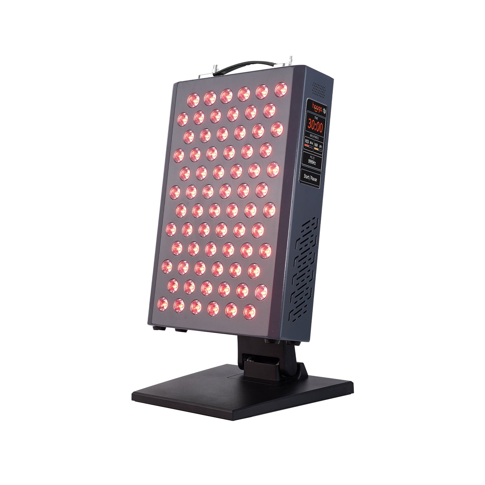
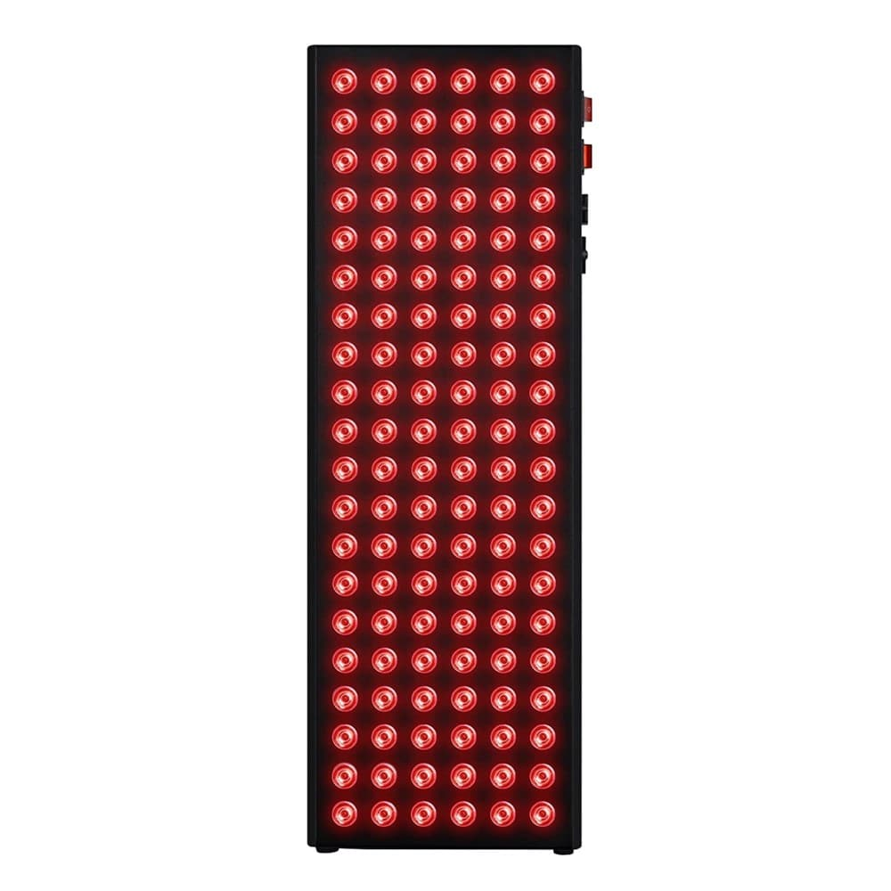
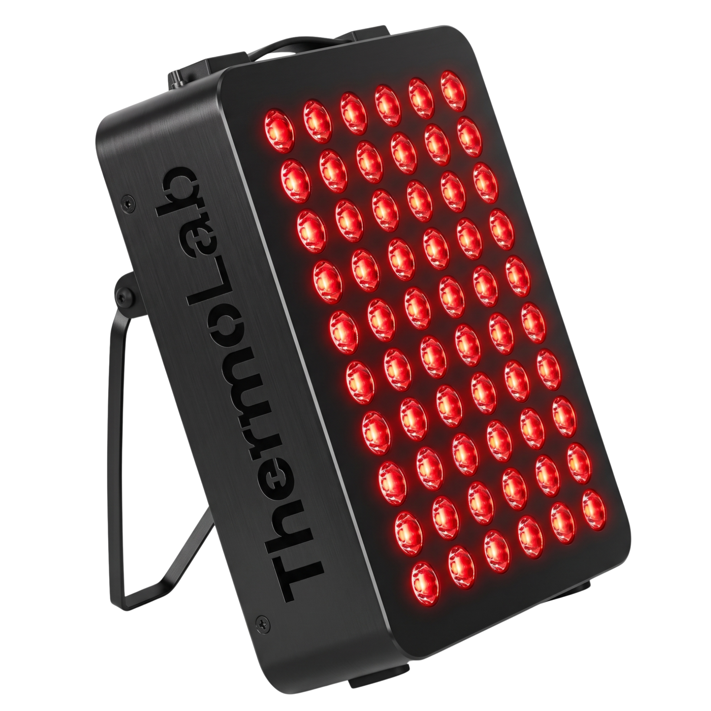
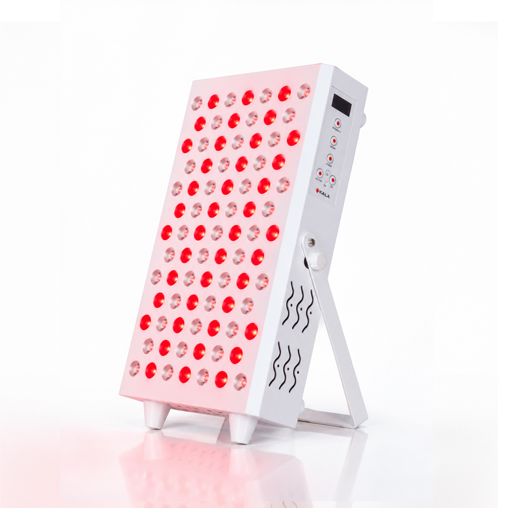
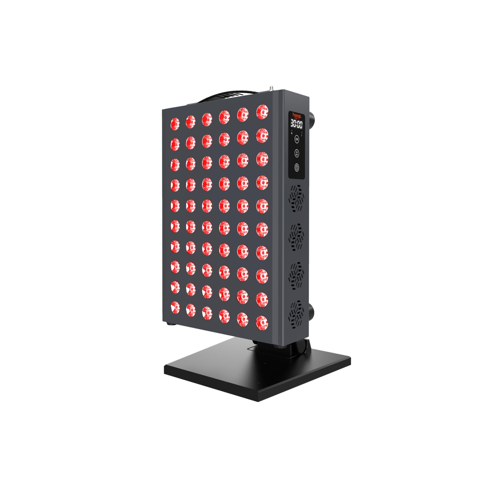
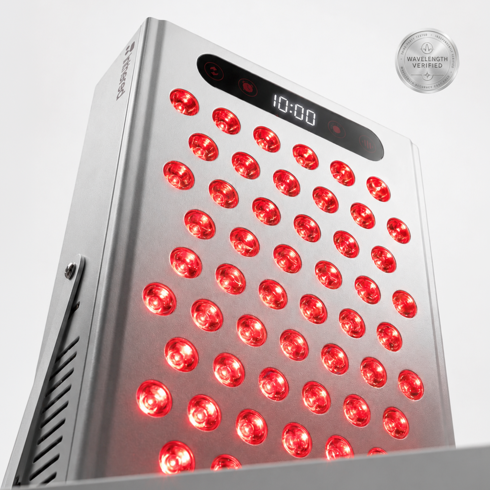
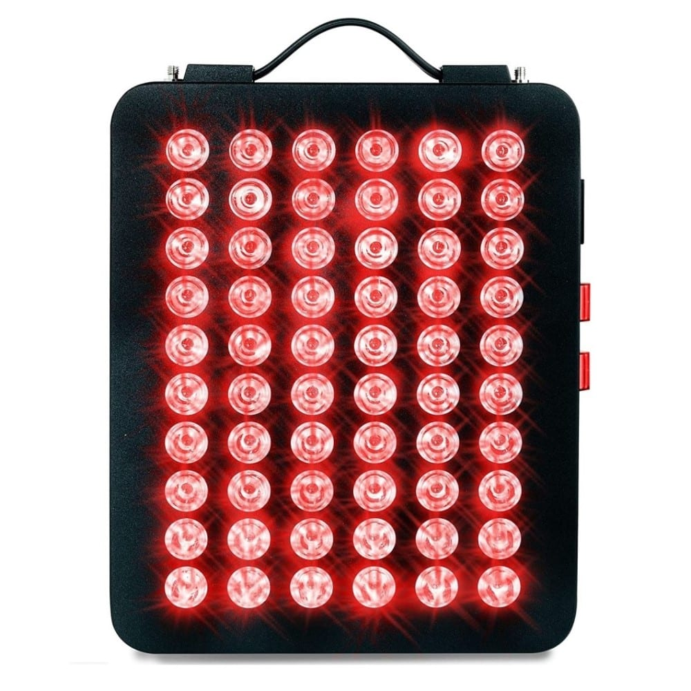
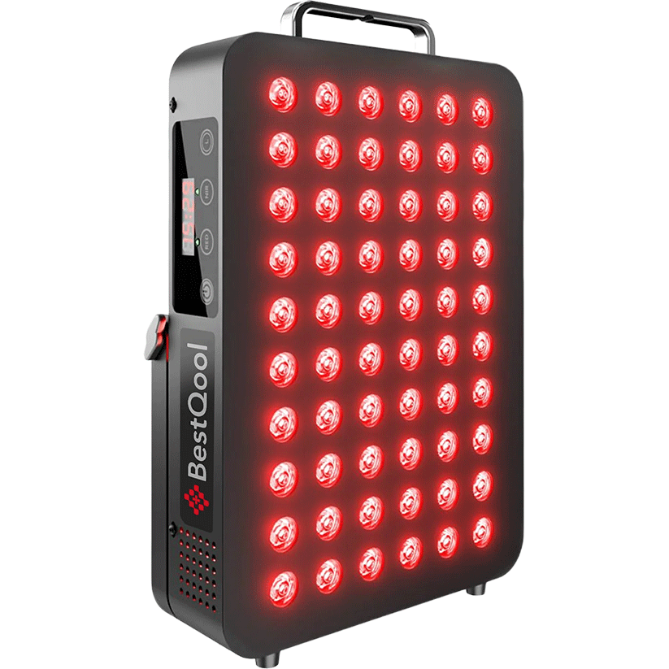
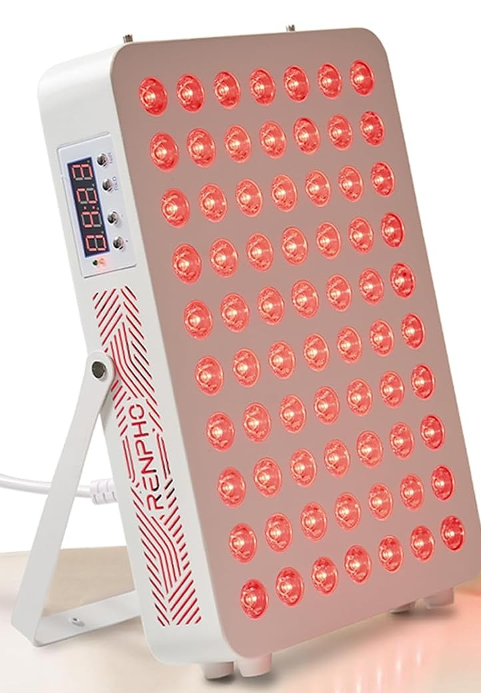
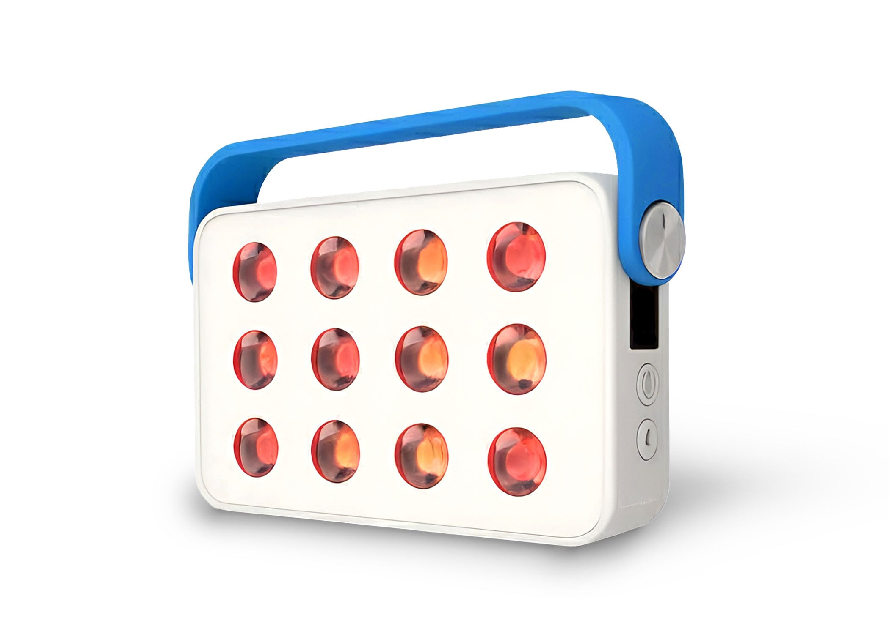

# Best Red Light Therapy Panels for Home Use in the UK 2026 — Innovation Lab Top 10

**CMS fields**
- Title: Best Red Light Therapy Panels for Home Use in the UK 2026
- Meta description: 10 red light therapy panels you can buy on Amazon.co.uk, ranked on published wavelengths, irradiance, warranty and UK support. Plain, specs-led, with safety notes.
- Primary keyword: `best red light therapy panel UK`
- Secondary keywords: red light therapy panel for home use, red light therapy UK, 660nm 850nm red light panel, near infrared light panel UK
- Suggested slug: `best-red-light-therapy-panels-home-use-uk-2026`
- Suggested URL: https://pickwisereviews.com/red-light-therapy/best-red-light-therapy-panels-home-use-uk-2026
- Suggested schema: ItemList (10 × Product, no AggregateRating/Offer price) + FAQPage; Article for the page wrapper
- Internal links: [/red-light-therapy](https://pickwisereviews.com/red-light-therapy), [/red-light-therapy/top-10](https://pickwisereviews.com/red-light-therapy/top-10), [/methodology](https://pickwisereviews.com/methodology), [/affiliate-disclosure](https://pickwisereviews.com/affiliate-disclosure)

---

Red light therapy panels have moved from clinics to UK living rooms, but listings are full of wattage claims that don't tell you much. This guide ranks ten panels you can buy on Amazon.co.uk today, from compact 300W-class units for face and joints to taller panels and one cordless option, using numbers you can check yourself.

**How we ordered this list:** we ranked on publicly verifiable information. That means manufacturer-published wavelengths, LED type, irradiance and the distance it is measured at, warranty, UK availability and support, and the number of Amazon.co.uk ratings seen on 9 November 2026. These are not PickWise lab scores, and we have not run controlled tests of these panels for this guide. Amazon buttons are plain amazon.co.uk links.

Related reading on PickWise: our [red light therapy hub](https://pickwisereviews.com/red-light-therapy), the [red light therapy top 10](https://pickwisereviews.com/red-light-therapy/top-10) and our [methodology](https://pickwisereviews.com/methodology) page.

Last updated: November 2026  
10 products compared  

Editorial Disclosure: PickWise Reviews may earn commissions from affiliate links in future. Rankings stay independent of merchants. [Affiliate disclosure](https://pickwisereviews.com/affiliate-disclosure).

**Safety note:** Red and near-infrared panels sold for home use are wellness devices. Nothing in this guide is medical advice, and brands' benefit claims are their own. Wear the eye protection supplied and never stare into the LEDs. Speak to your GP or pharmacist before use if you are pregnant, are on photosensitising medication, have a light-sensitive skin condition or a history of skin cancer, or have epilepsy (pulse modes can flicker). Keep sessions within the manufacturer's guidance and stop if you notice irritation.

## #1 — Hooga ULTRA360

**Editor's Choice · Best Overall** · Hooga

*Image source: [https://hoogahealth.com/products/ultra-360](https://hoogahealth.com/products/ultra-360)*

The most fully specified compact panel in this round-up. Every one of its 72 LEDs carries four chips (630, 660, 810 and 850 nm), and Hooga publishes a full irradiance-by-distance table rather than a single headline number. Touchscreen controls let you set red and near-infrared brightness separately, plus a 1–30 minute timer and pulse mode. It sits on a tabletop stand and is sized for face, neck, shoulders and joints rather than whole-body sessions. It leads this list on published specs, its three-year warranty and a solid Amazon.co.uk review base (4.6★ from 182 ratings on 9 Nov 2026).

### At a Glance

- **Wavelengths:** 630 / 660 nm red + 810 / 850 nm NIR (quad-chip)
- **LEDs:** 72 × 5W
- **Published irradiance:** 136 mW/cm² at 6" · 104 mW/cm² at 12" (manufacturer)
- **Coverage:** approx. 18" × 13" at 6" (manufacturer)
- **Controls:** Touchscreen, independent red/NIR brightness, 1–30 min timer, pulse
- **Warranty:** 3 years (manufacturer)

### What We Liked
- Four wavelengths from every LED
- Detailed, distance-by-distance irradiance published
- Independent red and NIR brightness control

### What to Consider
- Targeted size, not a full-body panel
- Tabletop use only; will not attach to Hooga mobile stands

[Check Price on Amazon →](https://www.amazon.co.uk/dp/B0CGC8HB5P)

## #2 — Nebula NB600 600W Red Light Therapy Panel

**Best Large Panel from a UK Company** · Nebula

*Image source: [https://nebula-appliances.com/product/nebula-led-red-light-therapy-lamp-600w](https://nebula-appliances.com/product/nebula-led-red-light-therapy-lamp-600w)*

If you want more than a face-and-shoulders panel, this is the bigger option here from a UK company (Vipertech Ltd, Peterborough). At 62 × 21 cm with 120 dual-chip LEDs it covers a much taller area in one session, and separate red and NIR switches let you run either or both. Nebula's UK manual quotes above 101 mW/cm² at 6" and 67 mW/cm² at 12". The trade-off: owner reviews on Nebula's own site point out there is no built-in timer, so you will need a plug timer or a phone alarm.

### At a Glance

- **Wavelengths:** 660 nm red + 850 nm NIR (dual-chip)
- **LEDs:** 120 × 5W dual-chip
- **Published irradiance:** >101 mW/cm² at 6" · >67 mW/cm² at 12" (NB600 manual)
- **Size / weight:** 62 × 21 × 6.5 cm · 4 kg
- **Controls:** Separate RED / NIR switches
- **Warranty:** 1 year + 1 year free extension (manufacturer)

### What We Liked
- Tall panel for torso or legs in one go
- UK-based company and support
- Door hanger and pulley kit included; trolley optional

### What to Consider
- No built-in timer (per owner feedback on Nebula's site)
- Heavier and harder to tuck away than a 300W panel

[Check Price on Amazon →](https://www.amazon.co.uk/dp/B0C3CYBWNP)

## #3 — ThermoLab Aura Pro 300W

**Best Value · UK Brand** · ThermoLab

*Image source: [https://thethermolab.com/products/thermolab-aura-pro-300w](https://thethermolab.com/products/thermolab-aura-pro-300w)*

A UK-designed, UK-stocked 300W-class panel that is also sold through B&Q's marketplace. That is a useful signal for buyers who want a UK returns route. ThermoLab includes a door and wall suspension kit plus blackout goggles, uses a UK 3-pin cable and backs the panel with a three-year UK warranty. On 9 Nov 2026 it had the highest Amazon.co.uk rating of any panel in this round-up (4.7★, 97 ratings). As with every "300W" panel, that figure describes electrical rating, not light output.

### At a Glance

- **Wavelengths:** 660 nm red + 850 nm NIR
- **LEDs:** 60
- **Published irradiance:** >120 mW/cm² at 6" · >85 mW/cm² at 12" (manufacturer)
- **Size:** approx. 26 × 21 cm (manufacturer)
- **In the box:** Suspension kit (door/wall), blackout goggles, UK 3-pin cable
- **Warranty:** 3 years UK (manufacturer)

### What We Liked
- Three-year UK warranty
- Strong Amazon.co.uk rating
- Also sold via B&Q (diy.com) marketplace

### What to Consider
- Two wavelengths only
- Simple controls, no app or pulse modes

[Check Price on Amazon →](https://www.amazon.co.uk/dp/B0DQKT4GGH)

## #4 — Kala Red Light Pro Panel

**Best for Taller Coverage** · Kala

*Image source: [https://kalaredlight.com/products/kala-red-light-pro-panel](https://kalaredlight.com/products/kala-red-light-pro-panel)*

A Canadian brand that has built UK distribution through wellness retailers including Healf and The Wellness London. The Pro Panel uses 85 LEDs at 660 nm and 850 nm (138W, per Kala), stands on its own built-in stand and adds a digital display with 10/15/20-minute timers and Kala's Pulse Recovery+ frequency modes. It is a step up in size from the 300W-class panels below. Prices differ a lot between Amazon.co.uk and UK retailers, so check before you buy.

### At a Glance

- **Wavelengths:** 660 nm red + 850 nm NIR
- **LEDs:** 85 (138W, manufacturer)
- **Controls:** Digital display, 10/15/20 min timer, Pulse Recovery+ modes
- **Stand:** Built-in stand; door hanging kit available
- **UK retail:** Healf, The Wellness London, Amazon.co.uk

### What We Liked
- Larger half-body format
- Built-in stand plus pulse modes
- Stocked by established UK wellness retailers

### What to Consider
- Kala publishes less distance-by-distance irradiance data than Hooga or Nebula
- Amazon and retailer prices vary widely

[Check Price on Amazon →](https://www.amazon.co.uk/dp/B0CKTV1YF1)

## #5 — Hooga PRO300

**Best Targeted Panel with Stand** · Hooga

*Image source: [https://hoogahealth.com/products/hgpro300](https://hoogahealth.com/products/hgpro300)*

Hooga calls this its most popular panel, and it is the simpler sibling of the ULTRA360. You get 60 dual-chip LEDs with 660 nm and 850 nm from every LED (no 630/810 nm), a published 109 mW/cm² at 6", a digital timer, a carry handle and an adjustable tabletop stand in the box. Choose it over the ULTRA360 if you don't need four wavelengths or independent brightness control. It has the same three-year warranty.

### At a Glance

- **Wavelengths:** 660 nm red + 850 nm NIR (dual-chip, 1:1)
- **LEDs:** 60 × dual-chip 5W
- **Published irradiance:** 109 mW/cm² at 6" (manufacturer)
- **Size:** 12.7" × 8.6" × 3.1"
- **Extras:** Adjustable stand, digital timer, cooling fan, 60° beam
- **Warranty:** 3 years (manufacturer)

### What We Liked
- Dual-chip LEDs give even red/NIR coverage
- Stand included
- Same 3-year warranty as Hooga's premium line

### What to Consider
- Small Amazon.co.uk review base (14 ratings on 9 Nov 2026)
- No pulse or brightness control

[Check Price on Amazon →](https://www.amazon.co.uk/dp/B0CX6VQQHS)

## #6 — Inthered ITR-EVO 300W

**Most Transparent Specs** · Inthered

*Image source: [https://getinthered.com/products/itr-evo](https://getinthered.com/products/itr-evo)*

A newer UK-supported brand that focuses on proof. Inthered says its >156 mW/cm² figure is measured at the panel surface and checked by an independent third party, and it publishes a safety and quality report. In practice you get 60 dual-chip LEDs behind 30° lenses, an aluminium body, touchscreen modes (red, NIR or both), four brightness steps, 10/20/40 Hz pulse and a 5–30 minute auto-off timer. It ranks mid-table only because it is new: four Amazon.co.uk ratings on 9 Nov 2026.

### At a Glance

- **Wavelengths:** 660 nm red + 850 nm NIR (dual-chip, 1:1)
- **LEDs:** 60, 30° lenses
- **Published irradiance:** >156 mW/cm² at surface (third-party verified, per manufacturer)
- **Size:** 21 × 32 cm
- **Controls:** Touchscreen; 25–100% brightness; 10/20/40 Hz pulse; 5–30 min timer
- **Warranty:** 1 year (manufacturer)

### What We Liked
- Irradiance measurement method stated plainly
- Full touchscreen controls including pulse
- Goggles, door hanger and pulley kit included

### What to Consider
- Very few reviews yet
- Shorter 1-year warranty than most panels here

[Check Price on Amazon →](https://www.amazon.co.uk/dp/B0GNNQQZ8V)

## #7 — Nebula NB300 300W Red Light Therapy Panel

**Best Compact All-Rounder** · Nebula

*Image source: [https://nebula-appliances.com/product/nebula-led-red-light-device-300w](https://nebula-appliances.com/product/nebula-led-red-light-device-300w)*

The compact version of our #2 pick, and the most complete kit in the box at this size. Nebula ships a foldable tabletop stand, a door bracket, a wire hanging kit, rope hangers, goggles and a UK mains cable, and it has a built-in timer, which the NB600 lacks. Nebula quotes over 122 mW/cm² at 6". It is a sensible first panel if you mainly want face and upper-body sessions.

### At a Glance

- **Wavelengths:** 660 nm red + 850 nm NIR (dual-chip)
- **LEDs:** 60 × 5W dual-chip
- **Published irradiance:** >122 mW/cm² at 6" · 89 mW/cm² at 12" (manufacturer)
- **Size:** 26 × 21 × 7 cm (manufacturer)
- **Controls:** Separate RED / NIR switches, built-in timer
- **Warranty:** 1 year + 1 year free extension (manufacturer)

### What We Liked
- Stand plus three hanging options in the box
- Built-in timer
- UK company and support

### What to Consider
- Face and upper-body size only
- Two wavelengths, no pulse

[Check Price on Amazon →](https://www.amazon.co.uk/dp/B0B2X3Z77V)

## #8 — BestQool BQ60 (105W)

**Best Simple Touch Controls** · BestQool

*Image source: [https://www.bestqool.com/products/red-light-therapy-bq60](https://www.bestqool.com/products/red-light-therapy-bq60)*

BestQool is one of the more established panel makers, and the BQ60 is part of its Original Series: 60 dual-chip LEDs, a digital timer and three modes (660 nm, 850 nm or both). The Amazon.co.uk listing quotes up to 95.6 mW/cm² at 3" and includes a U-shaped stand, door hook and hanging cord. BestQool's irradiance is quoted at 3" while most rivals quote 6", so don't compare the headline numbers directly.

### At a Glance

- **Wavelengths:** 660 nm red + 850 nm NIR
- **LEDs:** 60 dual-chip
- **Published irradiance:** up to 95.6 mW/cm² at 3" (Amazon listing)
- **Rated power:** 105W
- **Size / weight:** 13.1 × 8.4 × 2.1 in · 2.2 kg (manufacturer)
- **Mounting:** U-shaped stand, door hook, hanging cord

### What We Liked
- Easy touch controls with three modes
- Stand and hanging kit included
- Established brand

### What to Consider
- Lower published irradiance than others here (and at a closer distance)
- New UK listing with a modest review count

[Check Price on Amazon →](https://www.amazon.co.uk/dp/B0HFK55XH7)

## #9 — RENPHO 70-LED Red Light Therapy Panel

**Best Known-Brand Budget Pick** · RENPHO

*Image source: [https://www.amazon.co.uk/dp/B0H25WL8CR](https://www.amazon.co.uk/dp/B0H25WL8CR)*

RENPHO is a familiar name from bathroom scales and massagers, and this tablet-sized panel is its first broad push into red light therapy on Amazon.co.uk. It packs 70 dual-chip LEDs (660/850 nm, 1:1) with single or combined modes, a built-in fold-out stand, a sling for drill-free door hanging, a six-setting timer and a cooling fan. RENPHO's 180 mW/cm² figure is measured at point-blank range, so treat it as a best case.

### At a Glance

- **Wavelengths:** 660 nm red + 850 nm NIR (dual-chip, 1:1)
- **LEDs:** 70 × 5W dual-chip
- **Published irradiance:** 180 mW/cm² at point-blank (Amazon listing)
- **Stand:** Built-in foldable stand + door sling
- **Timer:** 6 settings
- **Cooling:** Internal fan

### What We Liked
- Built-in stand, no extra brackets
- Known consumer brand with UK support
- Light enough to move between rooms

### What to Consider
- Irradiance quoted at zero distance only
- Young listing (11 ratings on 9 Nov 2026)

[Check Price on Amazon →](https://www.amazon.co.uk/dp/B0H25WL8CR)

## #10 — Ocushield Ocuglow Portable Red & Infrared Panel

**Best Cordless / Travel** · Ocushield

*Image source: [https://www.ocushield.com/products/portable-red-light-therapy-panel-by-ocushield](https://www.ocushield.com/products/portable-red-light-therapy-panel-by-ocushield)*

This is the only cordless option here, from UK brand Ocushield, a certified B-Corp founded by eye-care professionals that appeared on BBC Dragons' Den in 2021. It is a small 12-LED unit (630/660 nm red, 830/850 nm NIR) with an 8,000 mAh battery and a timer, designed for face, eye-area and spot sessions at 15–30 cm. It is far less powerful and covers far less than a mains panel. Buy it for portability, not coverage.

### At a Glance

- **Wavelengths:** 630 / 660 nm red + 830 / 850 nm NIR
- **LEDs:** 12
- **Published irradiance:** 130+ mW/cm² at 7.6 cm (distributor data sheet)
- **Battery:** 8,000 mAh, cordless
- **Size / weight:** 150 × 95 × 38 mm · 0.55 kg
- **Regulatory note:** Brand states FDA-registered Class I device (registration is not FDA approval)

### What We Liked
- Cordless and light
- UK brand with eye-care background
- Eye protection included

### What to Consider
- Small treatment area
- No Amazon.co.uk reviews yet (9 Nov 2026)

[Check Price on Amazon →](https://www.amazon.co.uk/dp/B0H988LLP6)

## Compare Products

Side-by-side comparison using manufacturer-published figures. Irradiance distances differ by brand, so compare like with like.

| # | Product | Wavelengths | LEDs | Published irradiance | Format | Warranty | Amazon.co.uk rating (9 Nov 2026) | |
|---:|---|---|---|---|---|---|---|---|
| 1 | Hooga ULTRA360 | 630/660 + 810/850 nm | 72 quad-chip | 136 mW/cm² @ 6" | Targeted, tabletop stand | 3 yrs | 4.6★ (182) | [Check Price →](https://www.amazon.co.uk/dp/B0CGC8HB5P) |
| 2 | Nebula NB600 600W Red Light Therapy Panel | 660 + 850 nm | 120 dual-chip | 101 mW/cm² @ 6" | Tall (62 cm), hang/trolley | 1+1 yrs | 4.4★ (184) * | [Check Price →](https://www.amazon.co.uk/dp/B0C3CYBWNP) |
| 3 | ThermoLab Aura Pro 300W | 660 + 850 nm | 60 | 120 mW/cm² @ 6" | Targeted, hang kit | 3 yrs UK | 4.7★ (97) | [Check Price →](https://www.amazon.co.uk/dp/B0DQKT4GGH) |
| 4 | Kala Red Light Pro Panel | 660 + 850 nm | 85 | Not given by distance | Half-body, built-in stand | See retailer | 4.6★ (39) | [Check Price →](https://www.amazon.co.uk/dp/B0CKTV1YF1) |
| 5 | Hooga PRO300 | 660 + 850 nm | 60 dual-chip | 109 mW/cm² @ 6" | Targeted, stand | 3 yrs | 4.6★ (14) | [Check Price →](https://www.amazon.co.uk/dp/B0CX6VQQHS) |
| 6 | Inthered ITR-EVO 300W | 660 + 850 nm | 60 dual-chip | 156 mW/cm² @ surface | Targeted, tilt stand/hang | 1 yr | 4.2★ (4) | [Check Price →](https://www.amazon.co.uk/dp/B0GNNQQZ8V) |
| 7 | Nebula NB300 300W Red Light Therapy Panel | 660 + 850 nm | 60 dual-chip | 122 mW/cm² @ 6" | Targeted, stand + hang | 1+1 yrs | 4.4★ (184) * | [Check Price →](https://www.amazon.co.uk/dp/B0B2X3Z77V) |
| 8 | BestQool BQ60 (105W) | 660 + 850 nm | 60 dual-chip | 95.6 mW/cm² @ 3" | Targeted, stand + hang | See listing | 4.6★ (25) | [Check Price →](https://www.amazon.co.uk/dp/B0HFK55XH7) |
| 9 | RENPHO 70-LED Red Light Therapy Panel | 660 + 850 nm | 70 dual-chip | 180 mW/cm² @ 0" | Targeted, built-in stand | See listing | 4.6★ (11) | [Check Price →](https://www.amazon.co.uk/dp/B0H25WL8CR) |
| 10 | Ocushield Ocuglow Portable Red & Infrared Panel | 630/660 + 830/850 nm | 12 | 130 mW/cm² @ 7.6 cm | Cordless handheld | 1 yr | No ratings yet | [Check Price →](https://www.amazon.co.uk/dp/B0H988LLP6) |

\* Nebula's 300W and 600W panels share one Amazon.co.uk review pool.

## Frequently Asked Questions

### What should I look for in a home red light therapy panel?

Check four things: the wavelengths (most panels here use 660 nm red and 850 nm near-infrared), whether the LEDs are dual-chip, the irradiance figure and the distance it was measured at, and the warranty and UK support. The wattage in a product name is the electrical rating, not the light output, so a "300W" panel does not emit 300W of light.

### Why do irradiance figures vary so much between brands?

Brands measure at different distances: at the surface, at 3", at 6" or at 12". Irradiance falls as you move back, so 180 mW/cm² at point-blank is not better than 109 mW/cm² at 6". Compare figures quoted at the same distance, and treat any number without a distance as marketing.

### Red light only, or red plus near-infrared?

Most panels in this list let you run 660 nm red, 850 nm near-infrared or both. Manufacturers generally position red for skin-surface routines and near-infrared for deeper-tissue or recovery routines. Separate switches or modes are useful if you want to use one at a time.

### How long and how often do people use these panels?

Manufacturers in this round-up typically suggest about 10–20 minutes per area, 3–5 times a week, at roughly 15–30 cm (6–12") from the skin. Follow the manual for your specific panel, because recommended distances and times differ.

### Is red light therapy safe to use at home?

These are consumer wellness devices. They are not a substitute for medical advice or treatment. Use the goggles supplied, don't stare into the LEDs, and speak to your GP or pharmacist first if you are pregnant, have a light-sensitive condition, take photosensitising medication, have a history of skin cancer, or have epilepsy (some panels have pulse/flicker modes). Stop if you notice irritation or discomfort.

### Do I need a full-body panel?

Not usually for a first panel. Targeted 300W-class panels like the Hooga PRO300, ThermoLab Aura Pro or Nebula NB300 suit face, neck, shoulders and joints and are easier to store. Taller panels like the Nebula NB600 or Kala Pro Panel cover more of the body in one session but take up more space.

### Why are there no prices in this guide?

Amazon.co.uk prices for these panels change often and vary between sellers. Use the Check Price button for today's price and check the seller, warranty and returns before you buy.

## Ready to Choose?

For most UK homes, a targeted panel such as the **Hooga ULTRA360**, **ThermoLab Aura Pro 300W** or **Nebula NB300** is the practical starting point. Go for the **Nebula NB600** or **Kala Pro Panel** if you want more coverage, or the **Ocushield Ocuglow** if you need something cordless. Browse more in our [red light therapy hub](https://pickwisereviews.com/red-light-therapy).
